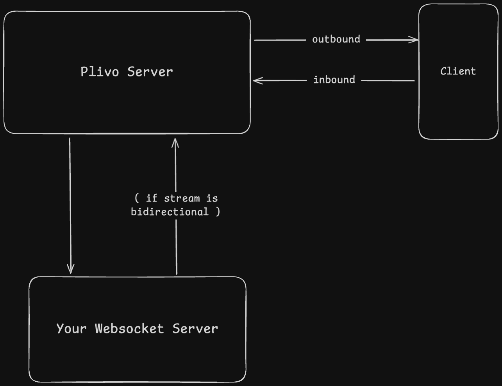

# Python SDK for the Plivo Streaming API

## Features
- **FastAPI Integration**: Native support for FastAPI WebSocket connections
- **WebSockets Library**: Support for the standard websockets library
- **Event-Driven**: Register callbacks/hooks for different events
- **Easy Media Handling**: Simple methods to send and receive media
- **Type-Safe**: Full type hints and Pydantic models for better IDE support
- **Modular Design**: Built to support multiple frameworks

## Installation
```bash
pip install plivo-stream-sdk
```

For development (includes uvicorn for running examples):

```bash
pip install -e[dev]
```

## Quick Start

### FastAPI Example

```python
from fastapi import FastAPI, WebSocket
from plivo_stream import PlivoFastAPIStreamingHandler, MediaEvent

app = FastAPI()

@app.websocket("/stream")
async def websocket_endpoint(websocket: WebSocket):
    handler = PlivoFastAPIStreamingHandler(websocket)
    
    @handler.on_connected
    async def on_connect():
        print("Client connected!")
    
    @handler.on_media
    async def on_media(event: MediaEvent):
        audio_bytes = event.get_raw_media()  # raw decoded bytes
        print(f"Received {len(audio_bytes)} bytes at chunk {event.media.chunk}")
    
    @handler.on_disconnected
    async def on_disconnect():
        print("Client disconnected!")
    
    await handler.start()
```

### WebSockets Library Example

```python
import asyncio
import websockets
from plivo_stream import PlivoWebsocketStreamingHandler
from plivo_stream import MediaEvent

async def create_handler(websocket):
    handler = PlivoWebsocketStreamingHandler()
    
    @handler.on_connected
    async def on_connect():
        print("Client connected!")
    
    @handler.on_media
    async def on_media(event: MediaEvent):
        audio_bytes = event.get_raw_media()
        print(f"Received {len(audio_bytes)} bytes")
    
    @handler.on_disconnected
    async def on_disconnect():
        print("Client disconnected!")
    
    await handler.handle(websocket)

async def main():
    async with websockets.serve(create_handler, "0.0.0.0", 8000):
        await asyncio.Future()  # run forever

if __name__ == "__main__":
    asyncio.run(main())
```

## Architecture



The SDK acts as a bridge between Plivo's server and your application, handling bidirectional audio streaming.

## Examples

* [Minimal Websocket example](https://github.com/plivo/plivo-stream-sdk-python/blob/main/examples/websockets_example.py)
* [Minimal FastAPI example](https://github.com/plivo/plivo-stream-sdk-python/blob/main/examples/fastapi_example.py)
* [Demo using FastAPI, Deepgram STT, ElevenLabs TTS, OpenAI LLM](https://github.com/plivo/plivo-stream-sdk-python/blob/main/examples/demo/README.md)

## API Reference

### PlivoFastAPIStreamingHandler

Main class for handling FastAPI WebSocket connections.

#### Initialization

```python
handler = PlivoFastAPIStreamingHandler(websocket)
```

#### Event Hooks

Register callbacks using decorators:

**`@handler.on_connected`**  
Called when WebSocket connection is established.

```python
@handler.on_connected
async def on_connect():
    print("Connected!")
```

**`@handler.on_disconnected`**  
Called when WebSocket connection is closed.

```python
@handler.on_disconnected
async def on_disconnect():
    print("Disconnected!")
```

**`@handler.on_media`**  
Called when media (audio) data is received.

```python
@handler.on_media
async def on_media(event: MediaEvent):
    # Access Pydantic fields
    print(event.media.track, event.media.timestamp, event.media.chunk)
    # Get raw decoded audio bytes
    audio_bytes = event.get_raw_media()
```

**`@handler.on_start`**  
Called when the stream starts; includes stream and call identifiers.

```python
@handler.on_start
async def on_start(event: StartEvent):
    print(f"Stream started: streamId={event.start.stream_id}, callId={event.start.call_id}")
```

**`@handler.on_dtmf`**  
Called when a DTMF tone is detected.

```python
@handler.on_dtmf
async def on_dtmf(event: DtmfEvent):
    print(f"DTMF received: {event.dtmf.digit}")
```

**`@handler.on_played_stream`**  
Called when buffered audio before a checkpoint has finished playing.

```python
@handler.on_played_stream
async def on_played_stream(event: PlayedStreamEvent):
    print(f"Checkpoint played: {event.name} on stream {event.stream_id}")
```

**`@handler.on_cleared_audio`**  
Called when the audio buffer is cleared.

```python
@handler.on_cleared_audio
async def on_cleared_audio(event: ClearedAudioEvent):
    print(f"Cleared audio on stream {event.stream_id}")
```

**`@handler.on_event(event_type)`**  
Called for specific Plivo event types.

```python
@handler.on_event("start")
async def on_start(event: StreamEvent):
    print(f"Stream started: {event.data}")
```

**`@handler.on_error`**  
Called when an error occurs.

```python
@handler.on_error
async def on_error(error):
    print(f"Error: {error}")
```

#### Sending Methods

**`send_media(media_data)`**  
Send media data through the WebSocket.

```python
# raw PCM/mulaw bytes (SDK will base64-encode for you)
await handler.send_media(audio_bytes)

# optionally specify content type and sample rate
await handler.send_media(audio_bytes, content_type="audio/x-l16", sample_rate=16000)
```

**`send_checkpoint(checkpoint_name)`**  
Send a checkpoint  event to track message processing.

```python
await handler.send_checkpoint("processing_complete")
```

**`send_clear_audio()`**  
Clear the audio buffer on the stream.

```python
await handler.send_clear_audio()
```

**`send_json(data)`**  
Send arbitrary JSON data.

```python
await handler.send_json({"event": "custom", "data": "value"})
```

**`send_text(message)`**  
Send text message.

```python
await handler.send_text("Hello")
```

#### Lifecycle Methods

**`start(with_signature_verification=False, auth_token=None, public_url=None, allow_legacy_signature=True)`**  
Start the WebSocket listener loop. This should be awaited in your endpoint.

```python
await handler.start()
```

Signature validation options:

- `with_signature_verification` (default `False`): validate the `X-Plivo-Signature-V3` header before accepting the connection. Invalid connections are rejected with HTTP 403 and `on_error` receives a `ValueError`
- `auth_token`: your Plivo auth token, required when `with_signature_verification` is `True`
- `public_url` (optional): public base URL of your stream endpoint as set in your `<Stream>` XML, e.g. `wss://example.com`. The request path and query are appended to it. Set it when a proxy in front of the server changes the scheme, host or path prefix. Without it, the URL is rebuilt from the request's Host header, using `wss` if `x-forwarded-proto` is `https` or `wss` (or, without that header, if the request itself uses TLS)
- `allow_legacy_signature` (default `True`): also accept the legacy signature format, computed over `http://host/path` with the query dropped. Transitional; it will be removed in a future release

Plivo signs the stream URL as configured: `ws`/`wss`, host and port, URL-decoded path, and the decoded query sorted by key. Versions before 0.2.0 reject these signatures.

```python
await handler.start(
    with_signature_verification=True,
    auth_token=os.environ["PLIVO_AUTH_TOKEN"],
    public_url="wss://example.com",  # only needed behind a proxy
)
```

**`stop()`**  
Stop the WebSocket listener and close the connection.

```python
await handler.stop()
```

### PlivoWebsocketStreamingHandler

Main class for handling plain WebSocket connections using the websockets library.

#### Initialization

```python
handler = PlivoWebsocketStreamingHandler()
```

#### Event Hooks

Same decorator-based event hooks as PlivoFastAPIStreamingHandler:
- `@handler.on_connected`
- `@handler.on_disconnected`
- `@handler.on_media`
- `@handler.on_start`
- `@handler.on_dtmf`
- `@handler.on_played_stream`
- `@handler.on_cleared_audio`
- `@handler.on_event(event_type)`
- `@handler.on_error`

#### Sending Methods

Same methods as PlivoFastAPIStreamingHandler:
- `send_media(media_data)`
- `send_checkpoint(checkpoint_name)`
- `send_clear_audio()`
- `send_json(data)`
- `send_text(message)`

#### Lifecycle Methods

**`handle(websocket)`**  
Handle a WebSocket connection. This should be called from your websockets.serve handler.

```python
async def connection_handler(websocket):
    await handler.handle(websocket)
```

**`stop()`**  
Stop the WebSocket listener and close the connection.

```python
await handler.stop()
```

### validate_stream_signature

`validate_stream_signature(url, headers, auth_token, allow_legacy_signature=True) -> bool`

Validates a stream connection's signature outside the FastAPI handler. `url` is the full stream URL the connection was made to (as configured in your `<Stream>` XML, path and query may be percent-encoded); `headers` is any mapping of the request headers, which must include `X-Plivo-Signature-V3` and `X-Plivo-Signature-V3-Nonce`. The signature header may hold several comma-separated signatures; the connection is valid if any of them matches.

For example, to reject unsigned connections during the handshake with the websockets library:

```python
from http import HTTPStatus
from plivo_stream import validate_stream_signature

def process_request(connection, request):
    url = "wss://example.com" + request.path  # your public stream URL base
    if not validate_stream_signature(url, request.headers, os.environ["PLIVO_AUTH_TOKEN"]):
        return connection.respond(HTTPStatus.FORBIDDEN, "Invalid signature\n")

async with websockets.serve(create_handler, "0.0.0.0", 8000, process_request=process_request):
    await asyncio.Future()
```

## Event Types

The SDK recognizes these Plivo Streaming API events:

- `connected` - WebSocket connection established
- `disconnected` - WebSocket connection closed
- `media` - Audio data received
- `start` - Stream started
- `error` - Error occurred
- `playedStream` - Audio events buffered before the Checkpoint were successfully played out to the end user
- `clearedAudio` - Cleared all buffered media events
- `dtmf` - Sent when someone presses a touch-tone number key in the inbound stream

